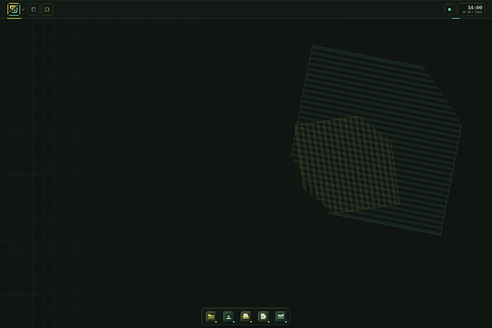
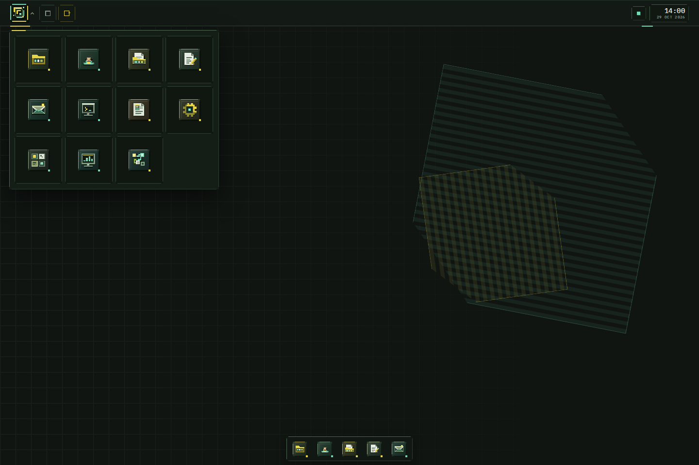

# osbio 

A browser portfolio that behaves like a small desktop environment. The shell is icon-first, with a custom Pixel-Flow emblem and segmented outlines, draggable app windows, a dock, and local-first workspace tools. Built with vanilla HTML, CSS, and JavaScript; no framework or build step.

<p align="center">
  <a href="https://shimleabyte.github.io/osbio/"><strong>OPEN THE LIVE DESKTOP</strong></a>
  &nbsp; / &nbsp;
  <a href="https://github.com/shimleabyte/osbio"><strong>SOURCE</strong></a>
</p>

## Screenshots

<table>
  <tr>
    <td width="50%" valign="top">
      <a href="https://shimleabyte.github.io/osbio/"></a>
      <p><strong>Desktop</strong><br /><sub>Quiet workspace with icon-only chrome and a custom geometric wallpaper.</sub></p>
    </td>
    <td width="50%" valign="top">
      <a href="https://shimleabyte.github.io/osbio/"></a>
      <p><strong>Application launcher</strong><br /><sub>Eleven custom app glyphs, without persistent text labels.</sub></p>
    </td>
  </tr>
</table>

<p><sub>Captures are taken by the Playwright Chromium smoke test from the real static UI, not mockups.</sub></p>

## Shell behavior

- A short, skippable boot sequence introduces the Pixel-Flow mark, then opens to an intentionally quiet, icon-only desktop. No app or guide opens automatically.
- The topbar keeps the product mark, window overview, optional Field Guide, local-session indicator, and clock/date. Visible text stays out of the idle shell except for the time and date; controls keep accessible names.
- The launcher opens as an eleven-app icon grid from the top-left mark or with `Ctrl+K`. Typing filters the focused launcher; app names remain available to assistive technology.
- The optional Field Guide provides three concrete routes (Projects, Profile, Editor), tracks visited stops locally, can be dismissed, and can be reopened from its topbar icon.
- Custom inline SVG app glyphs and the split-corner Pixel-Flow outline system are shared across the desktop shortcuts, launcher, dock, app title bars, and topbar controls.
- The taskbar pins five core workspace apps. Supporting apps and utilities appear as session-recent taskbar items the first time they launch; all apps remain available from the launcher. Selecting the active taskbar item minimizes it; selecting it again restores it.
- App windows can be focused, dragged, resized on desktop, maximized/restored, minimized, and closed. Double-click a title bar to toggle maximize.
- On narrow screens, the shell becomes a single-window workspace with touch-sized controls, compact topbar spacing, and an icon-grid launcher.
- Files and Editor share a browser-local virtual workspace with IndexedDB-backed persistence, explicit fallback status, a keyboard-accessible context menu, destination-aware moves, and an in-app Save/Discard/Keep editing prompt for unsaved documents.
- Settings changes persist browser-local appearance preferences; System Monitor reports actual OSBio state only (not host CPU/RAM).
- Flow Monitor records up to 160 events in the current tab, lets users filter/inspect/export them as JSON, and does not upload the trace.
- Memory Match uses keyboard-operable symbol cards. Restart cancels pending turn timers.
- Projects presents a compact selection list beside a dedicated detail pane for verified repository metadata.
- IBM Plex Sans and IBM Plex Mono are self-hosted in `assets/fonts/` under the accompanying SIL Open Font License; the runtime does not request Google Fonts.
- Resume shows an explicit unavailable state until the real PDF is published.
- The topbar, logo, and launcher use a restrained dark-green / mint / yellow palette with interrupted, pixel-aligned keylines rather than generic rounded UI borders.

The field guide uses a versioned browser-local preference (`osbio.wayfinder.v2`) for its dismissal and explored-stop progress. It does not require sign-in and does not transmit visitor activity.

## Local workspace data

OSBio now initializes a browser-local workspace using IndexedDB, with a localStorage or in-memory fallback when IndexedDB is unavailable. The first run seeds read-only Documents and Projects folders. User-created files are stored locally in this browser; they are not synced to other browsers or devices. Storage capability and limitations are exposed to the desktop instead of pretending that persistence always succeeded.

The storage layer supports text files and folders, rename/move/delete validation, strict JSON import validation (duplicate IDs, missing/non-folder parents, cycles and transfers above a 12 MiB UTF-8 byte limit are rejected), portable export that rebases user content out of omitted built-in folders, a bounded event history, and explicit storage status. Desktop-mode geometry is persisted per app, but open windows are never restored on reload. It does not read or write the host operating system's file system.

## Apps

| Tier | App | Purpose |
|---|---|---|
| Core | Projects | Compact project list with a dedicated detail pane and verified repository links |
| Core | Profile | Background, current focus, and technologies used in the portfolio projects |
| Core | Files | Browse the browser-local virtual workspace; create folders and text files, rename/move/delete user items, and import/export user data |
| Core | Editor | Open and save virtual text documents, with read-only built-in documents and Save Copy |
| Core | Contact | Email and GitHub |
| Supporting | Terminal | Simulated prompt for exploring project links and opening apps |
| Supporting | Resume | Unavailable state until a real PDF is published; no fabricated preview or download |
| Supporting | Settings | Persist local wallpaper, accent, motion and desktop shortcut preferences |
| Utilities | System Monitor | Show real in-session windows, virtual workspace counts, storage mode and recent events |
| Utilities | Flow Monitor | Inspect, filter and export a bounded trace of real OSBio state transitions |
| Utilities | Memory Match | Small symbol-matching game |

The terminal is a UI simulation for navigating this browser workspace. It does not execute host operating-system commands.

## Run locally

```sh
git clone https://github.com/shimleabyte/osbio.git
cd osbio
python3 -m http.server 8000
```

Open http://localhost:8000. Any static file server works.

The actual resume PDF is not published in this repository. When ready, add the real document as `resume.pdf` and wire its preview/download controls deliberately.

## Structure

```
index.html          shell panels, desktop shortcuts, launcher, taskbar
css/main.css        design tokens, local font faces, Pixel-Flow shell, and app styles
assets/fonts/       self-hosted IBM Plex WOFF2 assets and OFL license
js/osbioCore.js     IndexedDB/local fallback, virtual filesystem and event history
js/osbioSettings.js browser-local shell preferences
js/projectData.js  canonical project metadata
js/windowManager.js app templates, window state, focus, drag, resize and overview
js/workspaceApps.js Files, Editor, Settings, System Monitor and Flow Monitor behavior
js/main.js         boot flow, launcher focus/search and system clock
tests/             source contracts and Playwright Chromium smoke suite
```

## Interaction and accessibility

- Keyboard: `Ctrl+K` opens the launcher; `Escape` dismisses transient UI; `Alt+F4` closes the active app window.
- Window controls have explicit labels and visible focus states.
- Reduced-motion preference shortens boot and disables non-essential motion.
- OSBio is a browser desktop simulation, not a native OS or authentication system. It stores workspace data in the current browser; it does not execute host shell commands or access the host file system.

## License

See [LICENSE](LICENSE).

## Checks

Run the dependency-free source and shell-contract tests with Node.js 18 or newer:

```sh
node --test tests/source-smoke.test.mjs
```

GitHub Actions runs source-contract tests and a Chromium smoke suite on pushes to `main` and pull requests. The browser suite checks launcher/window navigation, shared project rendering, file persistence across reload, settings persistence, Memory Match, mobile layout, and uncaught JavaScript errors.

Built-in read-only documents include `Welcome.md`, `System Notes.md` and `Project Index.md`. The storage layer seeds new built-in notes into older workspaces without replacing user-created files.

Settings separates three actions: **Reset preferences** changes appearance options, **Reset window layout** returns open app windows to their default positions and clears saved geometry, and **Clear user files** removes only user-created workspace entries after confirmation.


